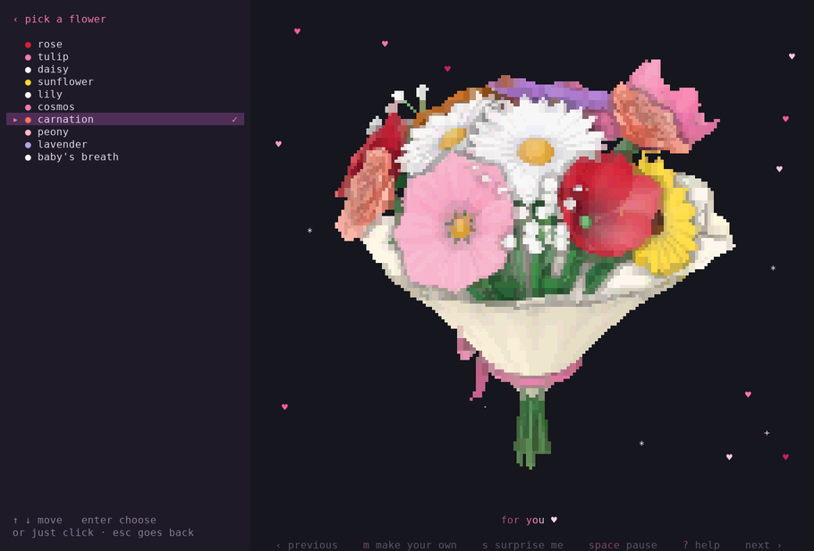
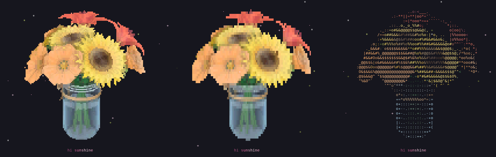

<div align="center">

# posy

**A little 3D bouquet for your terminal.**

It grows from bare stems, blooms, and slowly turns.<br>
Pick the flowers, write a message, and give it to someone.


[](https://github.com/kyledickey/posy/actions/workflows/ci.yml)
[](https://github.com/kyledickey/posy/releases/latest)
[](LICENSE)

</div>

Everything you see is text. Each flower is a real 3D model, drawn fresh
every frame and painted into your terminal with coloured block characters.

## Install

```sh
curl -fsSL https://raw.githubusercontent.com/kyledickey/posy/main/install.sh | sh
```

Works on macOS and Linux, Intel and ARM. The script downloads the right
build, checks it arrived intact, and puts it in `~/.local/bin`.

Then:

```sh
posy
```

<details>
<summary>Other ways to get it</summary>

- **From source**, with [Rust](https://rustup.rs) installed:
  `cargo install --git https://github.com/kyledickey/posy`
- **By hand:** grab the archive for your computer from the
  [latest release](https://github.com/kyledickey/posy/releases/latest),
  unpack it, and put `posy` somewhere on your `PATH`.
- **Options for the script:** `POSY_INSTALL_DIR=/some/where` to install
  elsewhere, `POSY_VERSION=0.1.0` for a particular version.

</details>

## Bouquets

There is a new bouquet every day, seven built in, and as many random ones
as you like.


```sh
posy                 # today's bouquet
posy -b roses        # a built-in one: classic, roses, wildflower,
                     #   sunset, spring, blush, midnight
posy -b random       # a surprise
posy list            # everything you can show, including your own
```

Add a name and it shows up wherever a message says `{name}`:

```sh
posy -b roses --name Sam --from me -m "for you, {name} ♥"
```

## Make your own

Press `m`, or click **make your own**. Everything in the menu works by
clicking or with the arrow keys, and the bouquet changes as you go.



- Ten flowers: rose, tulip, daisy, sunflower, lily, cosmos, carnation,
  peony, lavender and baby's breath, each in any colour.
- Five things to hold them: a paper cone, a glass vase, a jam jar, a
  basket, or just a ribbon.
- Hearts, petals, fireflies, snow, stars and sparkles floating around.
- **save this bouquet** keeps it, and `posy -b its-name` brings it back.

## Ask a question

The message can be big, coloured and moving, and it can be a question with
two answers to click.


Set it up in the menu under **words** and **a question**, or write it down:

```toml
# ask.toml
name = "ask"
message = "will you be my girlfriend?"
message_big = true
signature = "— me"
ask = true
yes_reply = "best day ever ♥"

[[flowers]]
kind = "rose"
count = 9
```

```sh
posy -b ask.toml --clean
```

Saying yes sets off a burst of hearts. `--clean` hides the buttons along
the bottom, so there is nothing on screen but flowers and words.

## Controls

Drag to turn the bouquet, scroll to zoom, and click the words along the
bottom. Or use the keyboard:

| key                  | does                                                    |
| -------------------- | ------------------------------------------------------- |
| arrows               | turn and tilt                                           |
| `+` `-` `0`          | closer, further, back to normal                         |
| `space`              | stop or start the turning                               |
| `[` `]`              | turn slower / faster                                    |
| `n` `p`              | next / previous bouquet                                 |
| `s`                  | surprise me                                             |
| `m`                  | make your own                                           |
| `r`                  | rearrange the flowers                                   |
| `g`                  | watch it grow again                                     |
| `1`–`6`              | hearts, petals, fireflies, snow, stars, sparkles        |
| `v`                  | change how it is drawn                                  |
| `h`                  | hide or show the buttons along the bottom               |
| `x`                  | save a picture (an `.html` page to send, and an `.ans`) |
| `/`                  | whisper a word…                                         |
| `?`                  | help                                                    |
| `q`                  | leave                                                   |

There may also be a secret or two.

## How it is drawn



Left to right: `fine`, `blocks` and `ascii`. posy picks the best one your
terminal can show; `v` switches while it runs, and `--style` or the config
file chooses for good.

| style    | what it is                                    | needs                                              |
| -------- | --------------------------------------------- | -------------------------------------------------- |
| `fine`   | each character cell painted as 2×4 squares    | a terminal that draws the newest block characters, like Ghostty or Kitty |
| `blocks` | 2×2 squares per cell                          | any terminal with full colour                      |
| `ascii`  | letters and symbols                           | anything                                           |

If you see little boxes with numbers in them instead of flowers, your
terminal can't draw `fine`: press `v`.

## Bouquet files

A bouquet is a small text file. `posy show classic` prints one to start
from; save yours in `~/.config/posy/bouquets/` and it appears in
`posy list`.

```toml
name = "ours"
message = "for you, {name} ♥"
wrap = "cone"               # cone, vase, jar, basket, bare
wrap_color = "cream"
ribbon_color = "red"
effects = ["hearts", "sparkles"]

[[flowers]]
kind = "rose"               # rose, tulip, daisy, sunflower, lily, cosmos,
count = 6                   #   carnation, peony, lavender, babys-breath
color = "red"               # a name like "blush", or "#rrggbb"

[[flowers]]
kind = "babys-breath"
count = 3
```

The words have their own settings:

```toml
message_big = true          # big pixel letters
message_color = "pink"
message_effect = "shimmer"  # shimmer, glow, rainbow, plain
signature = "— me"

ask = true                  # make it a question
yes = "yes ♥"               # the two answers...
no = "no"
yes_reply = "best day ever ♥"   # ...and what the message turns into
no_reply = "that's okay ♥"
```

## Settings

`posy init` writes `~/.config/posy/config.toml` with every setting
explained (it is also in [`examples/config.toml`](examples/config.toml)).
The ones worth knowing:

- **Who it's for:** `name` and `from`, and a list of `messages` to rotate
  through.
- **Special days:** a message, bouquet and effects for a date, such as an
  anniversary, with `{years}` counting up. Try one with `--date 02-14`.
- **Secret words:** press `/`, type one, and something happens.
- **Looks:** `style`, `spin_speed`, `fps`, and `buttons = false` to keep
  the bottom row hidden.

## Updating

```sh
posy update          # get the newest version
posy update --check  # only look
```

posy also looks once a day by itself and mentions a new version after you
close it, never while the bouquet is on screen. `update_check = false` in
the config turns that off.

## How it works

- **Flowers** ([`src/flowers.rs`](src/flowers.rs)) are built petal by
  petal. A petal is a curved sheet described by a few numbers: how long,
  how wide, how far it leans from base to tip, how much it wraps around
  the middle. Each kind of flower is a recipe for arranging them, and
  blooming is every petal leaning out from upright.
- **The arrangement** ([`src/scene/`](src/scene/)) spreads the heads over
  a dome and nudges neighbours apart until none pushes through another,
  then grows stems and leaves to them and builds the wrap.
- **Drawing** ([`src/render.rs`](src/render.rs),
  [`src/raster.rs`](src/raster.rs)) lights the triangles and fills them
  into a picture 4×8 times finer than the terminal, spread across your
  CPU cores. Each cell of that picture is then sorted into two colours
  and given the block character with that pattern. In ascii, a cell on an
  outline gets the character whose *shape* fits best, so an edge along
  the bottom becomes `_` and a diagonal becomes `/`.
- **The loop** ([`src/app.rs`](src/app.rs)) only sends the terminal the
  cells that changed, which is what keeps it smooth, even over ssh.

It is about 8,500 lines of Rust with no graphics libraries: the 3D is
done by hand.

## Working on it

```sh
cargo run --release              # run it
cargo test                       # test it
python3 tools/readme_media.py    # remake the pictures on this page
```

The pictures here are the program's own output, painted cell by cell by
[`tools/paint.py`](tools/paint.py).

To release: set the version in `Cargo.toml`, commit, then
`git tag v0.2.0 && git push origin v0.2.0`. The release workflow checks
the tag matches, builds for Linux and macOS (Intel and ARM each), tries
the install script against the result, and publishes it.

## Thanks

Inspired by [alishsharma17/Ascii-Flower-Bouquet-](https://github.com/alishsharma17/Ascii-Flower-Bouquet-)
(@alishsharma on TikTok).

## License

[MIT](LICENSE)
